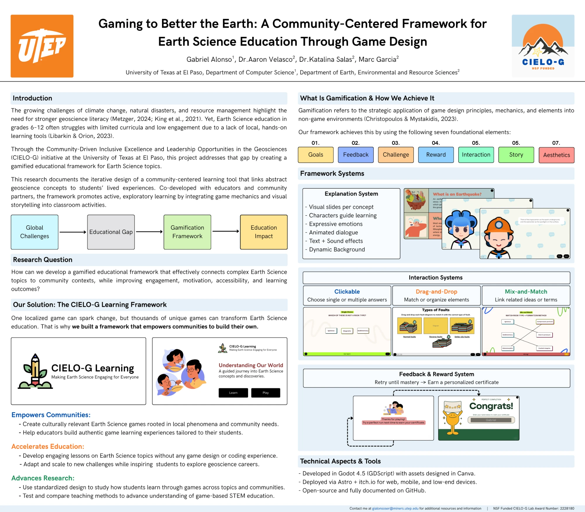

Undergraduate research at the University of Texas at El Paso, 2025, with the NSF-funded CIELO-G initiative (Award 2228180), across the Department of Computer Science and the Department of Earth, Environmental and Resource Sciences.

## Question

How can a gamified framework connect Earth Science topics to students' own communities while improving engagement, motivation, accessibility and learning in grades 6–12?

## Approach

One local game can spark change; a framework lets communities build their own. CIELO-G Learning gives educators reusable systems built on seven game elements: goals, feedback, challenge, reward, interaction, story and aesthetics.

- **Explanation:** visual slides per concept, guided by animated characters.
- **Interaction:** clickable answers, drag-and-drop, and mix-and-match.
- **Feedback and reward:** retry until mastery, then earn a personalized certificate.

Built in Godot 4.5 and deployed to the web, mobile and low-end devices.

::github{repo="arthifact/CIELO-G-Learning-Framework"}
